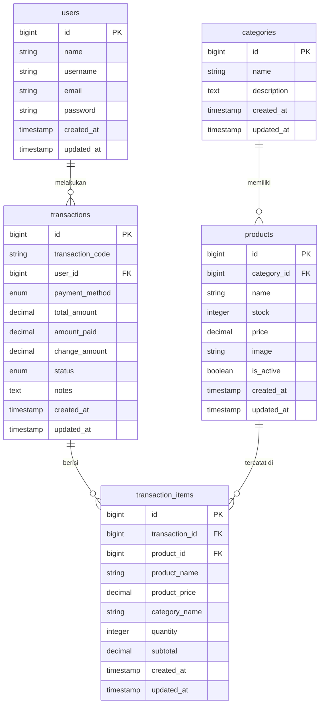

# Database & Model

Dokumentasi skema database, relasi antar tabel, dan cara kerja Eloquent Model di Mochimod ID.

---

## Diagram Relasi (ERD)



---

## Deskripsi Tabel

### `users`
Menyimpan data akun kasir/admin yang dapat login ke aplikasi.

| Kolom | Tipe | Keterangan |
|---|---|---|
| `id` | bigint PK | Auto-increment |
| `name` | string | Nama lengkap kasir |
| `username` | string | Username untuk login |
| `email` | string unique | Email untuk login |
| `password` | string | Password yang di-hash (bcrypt) |
| `created_at` | timestamp | Waktu akun dibuat |
| `updated_at` | timestamp | Waktu akun diperbarui |

### `categories`
Menyimpan kategori produk (contoh: Mochi, Jus).

| Kolom | Tipe | Keterangan |
|---|---|---|
| `id` | bigint PK | Auto-increment |
| `name` | string | Nama kategori |
| `description` | text nullable | Deskripsi kategori |
| `created_at` | timestamp | - |
| `updated_at` | timestamp | - |

### `products`
Menyimpan data produk yang dijual.

| Kolom | Tipe | Keterangan |
|---|---|---|
| `id` | bigint PK | Auto-increment |
| `category_id` | bigint FK | Referensi ke `categories.id` (cascade delete) |
| `name` | string(255) | Nama produk |
| `stock` | integer | Stok saat ini (default: 0) |
| `price` | decimal(10,2) | Harga satuan dalam Rupiah |
| `image` | string nullable | Path file gambar (disimpan di `storage/app/public/products/`) |
| `is_active` | boolean | Aktif/nonaktif; produk nonaktif tidak tampil di POS (default: true) |
| `created_at` | timestamp | - |
| `updated_at` | timestamp | - |

### `transactions`
Menyimpan satu record per transaksi penjualan.

| Kolom | Tipe | Keterangan |
|---|---|---|
| `id` | bigint PK | Auto-increment |
| `transaction_code` | string(20) unique | Kode unik format `TRX-YYYYMMDD-XXXX` |
| `user_id` | bigint FK | Kasir yang memproses (restrict on delete) |
| `payment_method` | enum | `'cash'` atau `'qris'` |
| `total_amount` | decimal(12,2) | Total belanja |
| `amount_paid` | decimal(12,2) nullable | Uang yang diterima (hanya untuk `cash`) |
| `change_amount` | decimal(12,2) nullable | Kembalian (hanya untuk `cash`) |
| `status` | enum | `'pending'`, `'completed'`, `'cancelled'` |
| `notes` | text nullable | Catatan opsional |
| `created_at` | timestamp | Waktu transaksi (zona WIB) |
| `updated_at` | timestamp | - |

**Index:** `(status, created_at)` dan `payment_method` untuk performa query laporan.

### `transaction_items`
Menyimpan detail item dalam satu transaksi (snapshot nama dan harga saat transaksi terjadi).

| Kolom | Tipe | Keterangan |
|---|---|---|
| `id` | bigint PK | Auto-increment |
| `transaction_id` | bigint FK | Referensi ke `transactions.id` (cascade delete) |
| `product_id` | bigint FK nullable | Referensi ke `products.id` (set null jika produk dihapus) |
| `product_name` | string(255) | **Snapshot** nama produk saat transaksi |
| `product_price` | decimal(12,2) | **Snapshot** harga produk saat transaksi |
| `category_name` | string | **Snapshot** nama kategori saat transaksi |
| `quantity` | unsigned int | Jumlah item yang dibeli |
| `subtotal` | decimal(12,2) | `product_price × quantity` |
| `created_at` | timestamp | - |
| `updated_at` | timestamp | - |

> **Mengapa snapshot?** Nama, harga, dan kategori produk disalin (snapshot) ke `transaction_items` agar riwayat transaksi tetap akurat meski produk diedit atau dihapus di kemudian hari.

---

## Relasi Eloquent

### `Category` Model
```php
// Category memiliki banyak Product
public function product(): HasMany
{
    return $this->hasMany(Product::class);
}
```

### `Product` Model
```php
// Product dimiliki oleh satu Category
public function category(): BelongsTo
{
    return $this->belongsTo(Category::class);
}
```

### `Transaction` Model
```php
// Transaction memiliki banyak TransactionItem
public function items(): HasMany
{
    return $this->hasMany(TransactionItem::class);
}

// Transaction dimiliki oleh satu User
public function user(): BelongsTo
{
    return $this->belongsTo(User::class);
}
```

### `TransactionItem` Model
```php
// TransactionItem dimiliki oleh satu Transaction
public function transaction(): BelongsTo
{
    return $this->belongsTo(Transaction::class);
}

// TransactionItem mereferensikan satu Product (nullable)
public function product(): BelongsTo
{
    return $this->belongsTo(Product::class);
}
```

---

## Konvensi Khusus

### Format Kode Transaksi
Kode transaksi digenerate otomatis oleh method `Transaction::generateCode()`:
- Format: `TRX-YYYYMMDD-XXXX` (contoh: `TRX-20261105-0001`)
- Nomor urut di-reset setiap hari
- Nomor di-pad dengan nol hingga 4 digit

### Timezone: WIB (Asia/Jakarta)
Semua timestamp disimpan dalam WIB, bukan UTC. Ini dilakukan melalui migrasi `2026_11_03_103000_convert_utc_to_wib_timestamps.php` yang mengkonversi data lama dan konfigurasi timezone aplikasi.

---

## Perintah Database

```bash
# Jalankan semua migrasi
php artisan migrate

# Reset semua tabel dan jalankan ulang migrasi
php artisan migrate:fresh

# Reset dan isi data awal
php artisan migrate:fresh --seed

# Hanya isi data awal (tanpa reset)
php artisan db:seed

# Lihat status migrasi
php artisan migrate:status
```

---

## Data Awal (Seeder)

`database/seeders/DatabaseSeeder.php` membuat:

**Akun Admin:**
- Email: `admin@mochimod.id`
- Password: `mochimod123`
- Username: `admin123`

**Kategori & Produk:**

| Kategori | Produk | Stok | Harga |
|---|---|---|---|
| Mochi | Mochi Cokelat | 20 | Rp 15.000 |
| Mochi | Mochi Stroberi | 15 | Rp 12.000 |
| Mochi | Mochi Matcha | 15 | Rp 14.000 |
| Mochi | Mochi Taro | 15 | Rp 14.000 |
| Mochi | Mochi Mangga | 15 | Rp 13.000 |
| Mochi | Mochi Keju | 15 | Rp 15.000 |
| Jus | Jus Jeruk | 20 | Rp 10.000 |
| Jus | Jus Mangga | 20 | Rp 12.000 |
| Jus | Jus Alpukat | 20 | Rp 15.000 |
| Jus | Jus Stroberi | 20 | Rp 13.000 |

---

## Navigasi Dokumentasi

- [← Arsitektur](./04-architecture.md)
- [Fitur Aplikasi →](./06-features.md)
